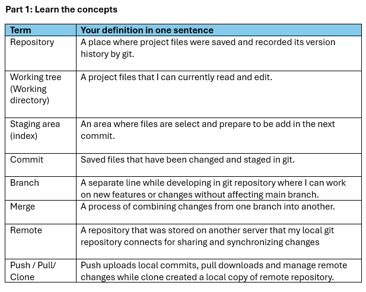

# Part 5: Reflection and evidence

##Q1: Why is a commit history useful when maintaining software? Give one concrete maintenance situation and refer to your own commits.

Commit history is useful because it allows developers to track changes made to a project and understand how the files have been modified over time. IF a problem occurs, developers can sheck previous commits to identify when the issue was introduced and what changes might ave caused it. In this activity, I created several commits, such as adding the README file, adding my anme and crating the .gitignore file. By looking at these commits, I can easily understand what I chnaged at each stage and keep track of my project development.

##Q2: Explain the difference between Git and GitHub, using your two repositories as examples.

Git is a version control tool that runs on my computer and allows me to track changes, create commits and manage branches.GitHub is an online platform that stores Git repositories and allows developers to share and collaborate on projects. In this activity, I used Git to manage my local scm-lab-evidence repository, while GitHub was used to host the repository online. I also used the GitHub Skills exercise repository to practise creating branches, commits, pull requests, and merging changes through the GitHub website.

##Q3. In the GitHub Skills exercise, you worked on a branch and used a pull request instead of changing main directly. What risk does this reduce?

Working on a separate branch and using a pull request reduces the risk of introducing unfinished or incorrect changes directly into the main branch. It allows changes to be reviewed and tested before they are merged into the main project. This helps prevent bugs from affecting the working version of the software and gives other team members the opportunity to check the changes. It also makes collaboration safer because different developers can work on separate features without directly affecting the main branch.

##Q4. State which of your commands changed only your computer and which changed GitHub.

Commands such as git init, git add, git commit, git branch, git switch, git merge, and git restore changed or managed my local repository on my computer. Commands such as git push uploaded my local commits to GitHub, while git clone downloaded a copy of the remote repository to my computer. The git pull command downloaded and integrated changes from GitHub into my local repository. These commands helped me understand how Git manages changes locally and how it synchronises work with a remote repository.

